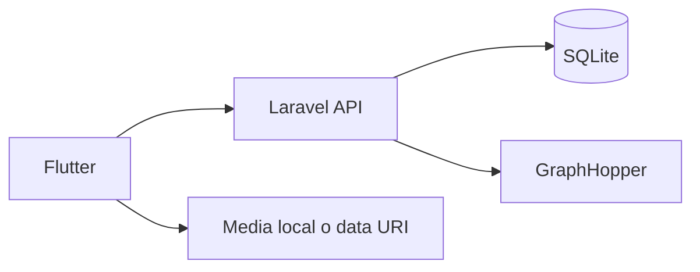

# CLAUDE.md

Guía operativa para agentes que trabajan sobre A4MPets.

## Propósito del repositorio

A4MPets es un monorepo con:

- `frontend/`: Flutter + Riverpod para la UI, el estado local y el cliente HTTP.
- `backend/`: Laravel 12 para API, dominio, persistencia y cálculo de rutas.
- `docker-compose*.yml`: orquestación del stack con GraphHopper.
- `features/`: documentos separados con pendientes de publicación y endurecimiento para Google Play.

La referencia de arquitectura es [docs/contexto_arquitectura_a4mpets.md](docs/contexto_arquitectura_a4mpets.md).

## Reglas de trabajo

- Prioriza la arquitectura y el dominio, no el área de pruebas.
- Trata `tests/`, `test-results/`, `coverage/` y `docs/evidencias/` como contexto histórico o auxiliar, no como fuente principal de diseño.
- Mantén el vocabulario del dominio: mascotas, reportes de peligro, reportes perdidos, reportes encontrados, rutas, viaje y media.
- Preserva el contrato entre Flutter y Laravel; el frontend consume JSON y el backend concentra permisos, validación y persistencia.
- Evita cambios amplios si un ajuste local resuelve el problema.
- Si agregas componentes, refactorizas o cambias responsabilidades, actualiza también la documentación existente de forma progresiva: corrige lo que ya describe el sistema, no solo anexes texto nuevo.
- La documentación viva debe mantenerse coherente; cuando el código cambie, revisa y ajusta `docs/contexto_arquitectura_a4mpets.md`, `README.md` y este archivo según corresponda.

## Puntos de entrada clave

### Backend

- `backend/routes/api.php`: contrato HTTP principal.
- `backend/app/Http/Controllers/`: controladores delgados.
- `backend/app/Services/`: reglas de negocio y orquestación.
- `backend/app/Models/`: persistencia y relaciones.
- `backend/app/Http/Requests/`: validación de payloads.
- `backend/app/Http/Middleware/ResolveApiTokenUser.php`: resolución del usuario por bearer token.

### Frontend

- `frontend/lib/main.dart`: arranque de Flutter.
- `frontend/lib/pages/map_page.dart`: orquestador principal de la UI.
- `frontend/lib/providers/`: estado de paneles, rutas, reportes, viaje, sesión y tema.
- `frontend/lib/services/backend_api_client.dart`: cliente HTTP con fallback de URLs.
- `frontend/lib/services/osm_routing_service.dart`: integración con `/routes/plan`.
- `frontend/lib/services/local_media_storage_service*.dart`: media local por plataforma.

### Infraestructura

- `docker-compose.yml`: stack local principal.
- `docker-compose.server.yml`: variante para servidor.
- `playwright.f5.config.js`: configuración de automatización de navegador disponible.
- `package.json`: scripts del workspace raíz.
- `features/`: backlog documental de publicación, privacidad, permisos, acceso y release.

## Flujo funcional resumido

## Archivos que suelen requerir cuidado

- `backend/routes/api.php`: cualquier cambio aquí altera el contrato del sistema.
- `backend/app/Services/GraphHopperRoutingService.php`: controla el cálculo de rutas y los fallos controlados.
- `frontend/lib/pages/map_page.dart`: concentra estado y coordinación de la pantalla principal.
- `frontend/lib/services/backend_api_client.dart`: define la estrategia de fallback de endpoints.
- `frontend/lib/services/local_media_storage_service_io.dart` y `frontend/lib/services/local_media_storage_service_web.dart`: bifurcan el manejo de imágenes por plataforma.

## Playwright

Playwright está instalado en el root del proyecto y se usa solo como automatización de navegador cuando hace falta.

- `playwright@1.59.1`
- `@playwright/test@1.59.1`
- Script: `npm run test:e2e:f5`

No mezclar esta capacidad con la definición de arquitectura. Si el cambio no depende de navegador, no es necesario traer Playwright al contexto.

## Estilo de edición

- Usa `apply_patch` para cambios de archivo.
- Evita reescrituras amplias si no son necesarias.
- Mantén Markdown claro, con rutas y responsabilidades explícitas.
- No renombres módulos o archivos sin necesidad fuerte.

## Lecturas de apoyo

- [docs/contexto_arquitectura_a4mpets.md](docs/contexto_arquitectura_a4mpets.md)
- `README.md`
- `backend/docs/All_Files.md`