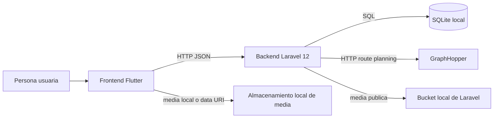
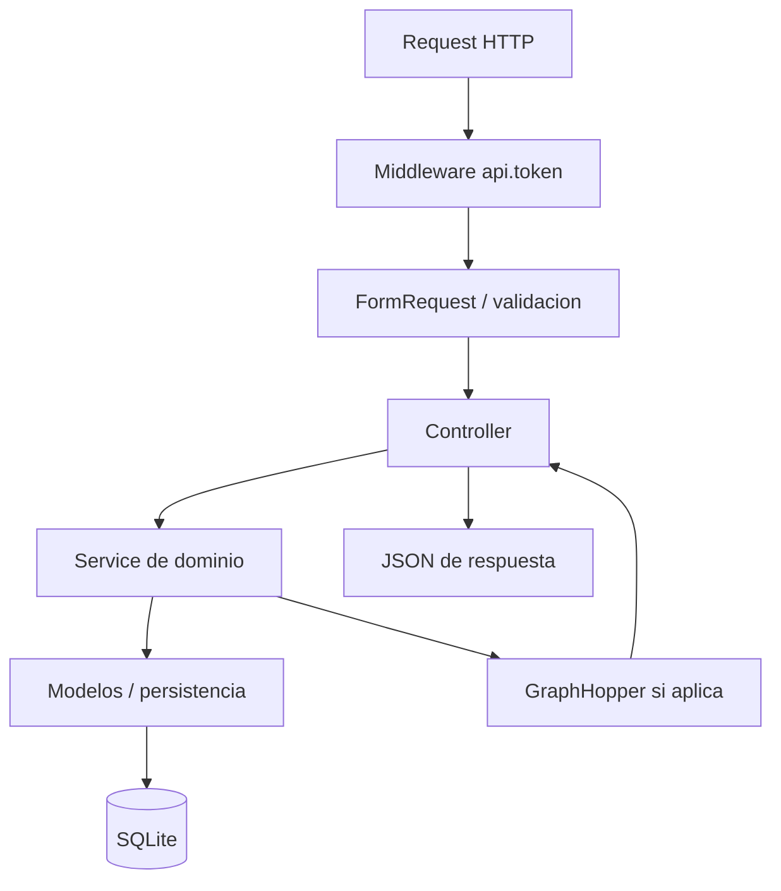
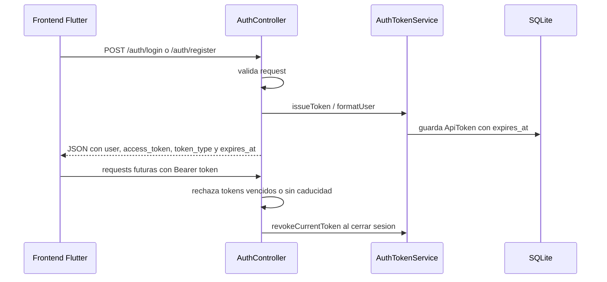
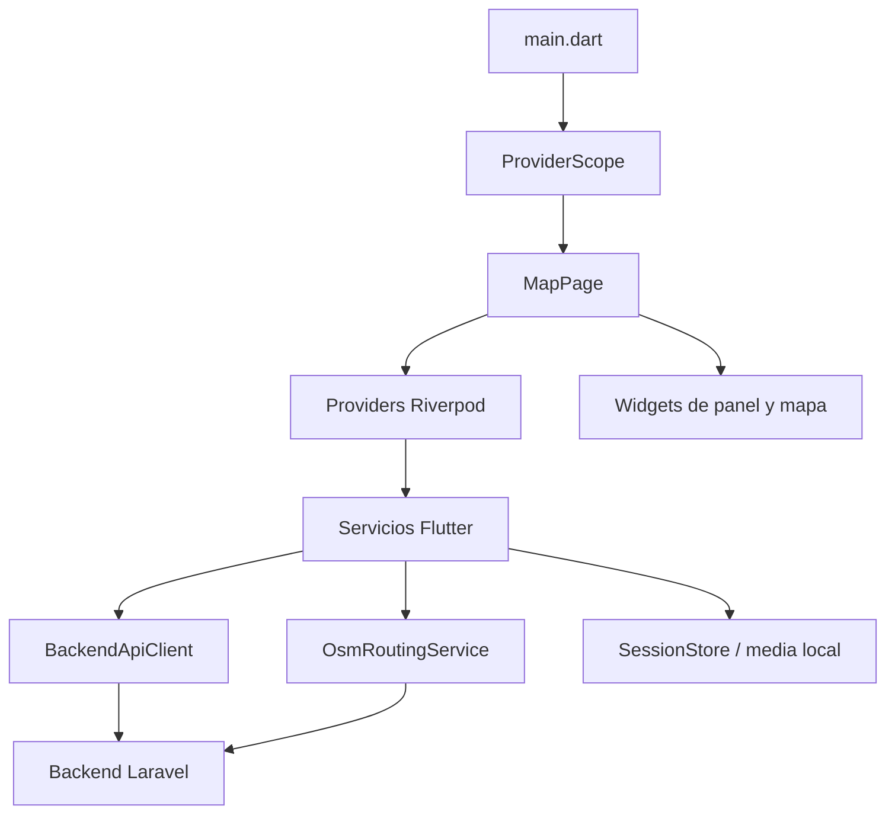
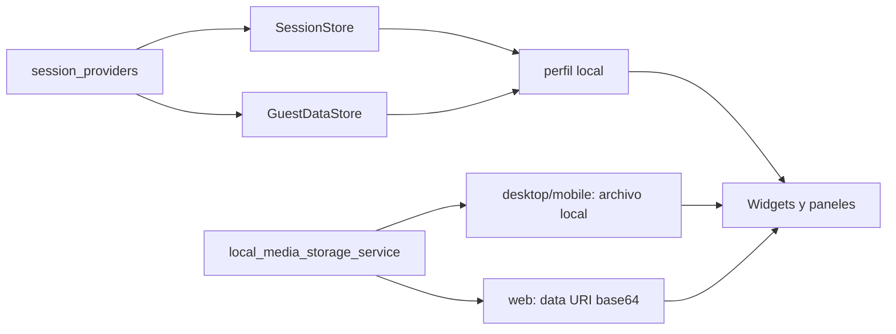
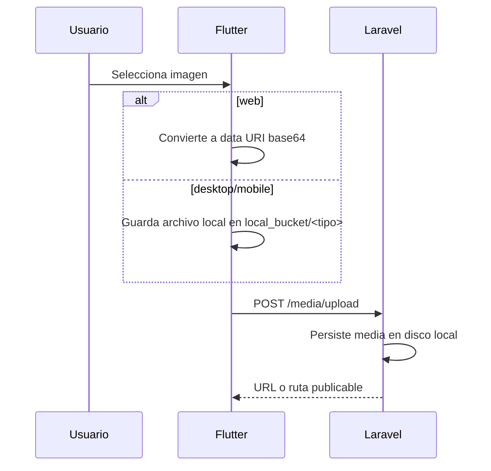
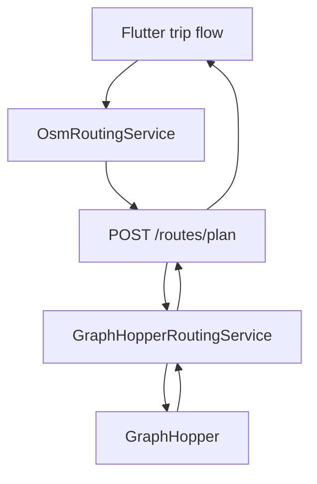

# Contexto de arquitectura de A4MPets

Este documento describe la arquitectura real del repositorio A4MPets para que una IA pueda entenderlo sin depender del area de pruebas. El foco aqui es la estructura de carpetas, las responsabilidades de los archivos relevantes, los flujos de datos y los puntos donde el sistema puede crecer en el futuro.

## Alcance y criterio de lectura

- Este archivo se usa como contexto de arquitectura y mantenimiento.
- El area de pruebas queda fuera de alcance operativo en este contexto. Los directorios `tests/`, `test-results/`, `coverage/`, `docs/evidencias/` y reportes generados se consideran artefactos historicos o auxiliares, no fuente principal de arquitectura.
- `Playwright` solo se documenta como capacidad disponible y verificada en el entorno, no como eje del sistema.
- Cuando una carpeta contiene codigo generado, salidas de cobertura o evidencia, eso se clasifica como soporte y no como definicion del dominio.
- Este documento es vivo: cuando se agreguen componentes, se refactorice la arquitectura o cambien responsabilidades, debe corregirse el contenido existente para reflejar el estado real del sistema, no solo anexar secciones nuevas.

## Vision general del sistema

A4MPets es un monorepo con tres capas funcionales principales:

1. `frontend/` contiene la interfaz Flutter, el estado local, los widgets y los servicios de presentacion.
2. `backend/` contiene la API Laravel, el dominio, la persistencia y la integracion con GraphHopper.
3. `docker-compose.yml` y `docker-compose.server.yml` coordinan backend, frontend y GraphHopper.

El flujo dominante es:

1. El usuario interactua con Flutter.
2. Flutter consulta o muta estado local y, cuando corresponde, llama al backend por HTTP.
3. Laravel valida, aplica reglas de dominio, persiste en SQLite y devuelve JSON.
4. Para ruteo, Laravel consulta GraphHopper y transforma la respuesta para que Flutter la consuma.

## Raiz del repositorio

| Archivo o carpeta | Responsabilidad |
|---|---|
| `README.md` | Guia minima de ejecucion y modos de arranque local o contenedorizado. |
| `package.json` | Orquestacion del workspace raiz: scripts para backend, frontend, GraphHopper, Cloudflare, Playwright y reportes. |
| `docker-compose.yml` | Composicion principal para produccion/local: backend, frontend y GraphHopper. |
| `docker-compose.server.yml` | Variante de composicion para servidor, con variables y healthchecks propios. |
| `compose.env.example` | Plantilla de variables de entorno para la composicion. |
| `playwright.f5.config.js` | Configuracion de ejecucion E2E F5 sobre Chromium desktop, con reportes y servidor efimero. |
| `app.json` | Configuracion minima de Expo heredada o auxiliar; no es un nodo central de la arquitectura actual. |
| `eas.json` | Configuracion auxiliar de build mobile/distribucion, si aplica. |
| `scripts/` | Scripts de orquestacion y utilidades del repo: arranque, PDF, Cloudflare, cobertura y reportes. |
| `postman/` | Colecciones y datos auxiliares para consumo manual o historico. |
| `features/` | Backlog documental separado por temas para pendientes de publicacion y endurecimiento en Google Play. |
| `docs/` | Documentacion funcional, tecnica y evidencia historica. |
| `scratch/` y `scratch.dart` | Espacio de experimentacion, no fuente de verdad de arquitectura. |

## Backend Laravel

### Responsabilidad general

El backend expone la API, controla permisos, normaliza entidades de dominio, persiste en SQLite y orquesta GraphHopper. Laravel no solo actua como CRUD; tambien concentra reglas de ownership, sincronizacion y transformacion de respuestas.

### Archivos de entrada y orquestacion

| Archivo | Responsabilidad |
|---|---|
| `backend/artisan` | Entrada de comandos Artisan. |
| `backend/composer.json` | Dependencias PHP, scripts y autoload PSR-4. |
| `backend/Dockerfile` | Imagen del backend para contenedores. |
| `backend/bootstrap/app.php` | Inicializa kernel, middleware y rutas. |
| `backend/bootstrap/providers.php` | Registra providers de la aplicacion. |
| `backend/public/index.php` | Front controller HTTP de Laravel. |
| `backend/routes/api.php` | Contrato HTTP JSON del sistema. |
| `backend/routes/web.php` | Ruta web basica de Laravel. |
| `backend/routes/console.php` | Comandos de consola del proyecto. |
| `backend/config/*.php` | Configuracion de auth, cache, CORS, database, filesystems, logging, mail, queue, session y services. |
| `backend/database/migrations/*.php` | Evolucion del esquema de datos. |
| `backend/database/seeders/DatabaseSeeder.php` | Datos base del entorno local. |

### API y controladores

`backend/routes/api.php` organiza el dominio por prefijos:

- `auth`: registro, login, perfil, logout y eliminacion de cuenta.
- `hazards`: reportes de peligros y comentarios.
- `lost-pet-reports`: reportes de mascotas perdidas y comentarios.
- `found-pet-reports`: reportes de mascotas encontradas y comentarios.
- `generic-reports`: reportes genericos y comentarios.
- `pets`: mascotas propias, listado y mutaciones.
- `routes`: rutas guardadas y planificacion.
- `media`: subida y lectura de imagenes.
- `health`: chequeo simple de disponibilidad.

Controladores relevantes:

- `backend/app/Http/Controllers/AuthController.php`: registro, login, perfil actual, logout, actualizacion de perfil y eliminacion de cuenta.
- `backend/app/Http/Controllers/PetController.php`: listado, detalle, alta, edicion, borrado y marcado como encontrada.
- `backend/app/Http/Controllers/TravelRouteController.php`: rutas guardadas y sincronizacion del CRUD.
- `backend/app/Http/Controllers/RoutePlanningController.php`: entrada HTTP para planificar con GraphHopper.
- `backend/app/Http/Controllers/MediaController.php`: subida y lectura de media publica.
- `backend/app/Http/Controllers/HazardReportController.php`: CRUD y comentarios de peligros.
- `backend/app/Http/Controllers/LostPetReportController.php`: CRUD y comentarios de reportes de perdida.
- `backend/app/Http/Controllers/FoundPetReportController.php`: CRUD y comentarios de reportes encontrados.
- `backend/app/Http/Controllers/GenericReportController.php`: CRUD y comentarios de reportes genericos.
- `backend/app/Http/Controllers/Controller.php`: base comun.

### Requests y validacion

Las clases de `backend/app/Http/Requests/` concentran validacion y shape de payload. Eso evita que el controlador conozca reglas detalladas de formulario.

- Auth: `LoginRequest`, `RegisterRequest`, `UpdateProfileRequest`.
- Pets: `StorePetRequest`, `UpdatePetRequest`.
- Hazards: `StoreHazardRequest`, `UpdateHazardRequest`, `StoreHazardCommentRequest`.
- Reports: `StoreLostPetReportRequest`, `UpdateLostPetReportRequest`, `StoreFoundPetReportRequest`, `UpdateFoundPetReportRequest`, `StoreGenericReportRequest`, `UpdateGenericReportRequest`, `StoreReportCommentRequest`.
- Routes: `StoreTravelRouteRequest`, `UpdateTravelRouteRequest`.

### Middleware

- `backend/app/Http/Middleware/ResolveApiTokenUser.php`: resuelve el usuario autenticado a partir del bearer token, exige `expires_at` vigente, elimina tokens vencidos o legacy sin caducidad y deja el token actual disponible en la request.

### Servicios de dominio

Los servicios son el centro de la logica real. Los controladores son delgados y delegan aqui.

| Archivo | Responsabilidad |
|---|---|
| `backend/app/Services/Auth/AuthTokenService.php` | Emite tokens con caducidad configurable, revoca el token actual y formatea usuarios. |
| `backend/app/Services/Auth/AccountDeletionService.php` | Elimina datos privados de cuenta y anonimiza reportes/comentarios comunitarios. |
| `backend/app/Services/Pets/PetService.php` | CRUD, paginacion, ownership, marcado como encontrada y sincronizacion de mascotas. |
| `backend/app/Services/Routes/TravelRouteService.php` | CRUD, ownership y sincronizacion de rutas guardadas. |
| `backend/app/Services/GraphHopperRoutingService.php` | Construye payloads, prueba URLs de respaldo, procesa respuesta y devuelve polilinea/instrucciones. |
| `backend/app/Services/Comments/ReportCommentService.php` | Gestion de comentarios transversales entre tipos de reporte. |
| `backend/app/Services/Comments/ReportCommentFormatter.php` | Normalizacion de estructura de comentarios. |
| `backend/app/Services/Hazards/HazardReportService.php` | CRUD y reglas de negocio de peligros. |
| `backend/app/Services/Hazards/HazardCommentSyncService.php` | Sincronizacion de comentarios y metadatos asociados a peligros. |
| `backend/app/Services/Hazards/HazardRoutingRiskFilter.php` | Normaliza filtros de riesgo para planeacion de ruta. |
| `backend/app/Services/Hazards/HazardValueNormalizer.php` | Normaliza valores/codigos de peligros. |
| `backend/app/Services/Hazards/HazardResponseFormatter.php` | Formatea la respuesta de peligros para consumo uniforme. |
| `backend/app/Services/Reports/LostPetReportService.php` | CRUD y sincronizacion de reportes de mascota perdida. |
| `backend/app/Services/Reports/FoundPetReportService.php` | CRUD y sincronizacion de reportes de mascota encontrada. |
| `backend/app/Services/Reports/GenericReportService.php` | CRUD y sincronizacion de reportes genericos. |

### Modelos de dominio

Los modelos expresan persistencia y relaciones. Son la representacion del estado del backend.

| Archivo | Rol principal |
|---|---|
| `backend/app/Models/User.php` | Usuario autenticable. |
| `backend/app/Models/ApiToken.php` | Token persistido de autenticacion propia. |
| `backend/app/Models/Pet.php` | Mascotas sincronizables. |
| `backend/app/Models/LostPetReport.php` | Reportes de mascota perdida. |
| `backend/app/Models/FoundPetReport.php` | Reportes de mascota encontrada. |
| `backend/app/Models/GenericReport.php` | Reportes genericos. |
| `backend/app/Models/HazardReport.php` | Reportes de peligro. |
| `backend/app/Models/HazardComment.php` | Comentarios de peligro. |
| `backend/app/Models/ReportComment.php` | Comentarios transversales de reportes. |
| `backend/app/Models/TravelRoute.php` | Rutas guardadas. |
| `backend/app/Models/RoutePoint.php` | Puntos individuales de una ruta. |
| `backend/app/Models/HazardCategory.php` | Catalogo de categorias de peligro. |
| `backend/app/Models/HazardRiskLevel.php` | Catalogo de niveles de riesgo. |
| `backend/app/Models/HazardEstimatedDuration.php` | Catalogo de duracion estimada de peligro. |

### Soporte y formato

- `backend/app/Support/NavigationInstructionFormatter.php`: normaliza instrucciones de navegacion para la UI.
- `backend/app/Providers/AppServiceProvider.php`: provider general sin extensiones arquitectonicas complejas.

### Persistencia

Las migraciones muestran la evolucion del dominio:

- `create_users_table`, `create_cache_table`, `create_jobs_table`: base de Laravel.
- `create_api_tokens_table`: autenticacion propia del backend.
- `create_pets_table`: mascotas.
- `create_routes_table`: rutas guardadas.
- `create_hazard_reports_table` y migraciones de normalizacion: peligros y catalogos.
- `create_hazard_comments_table`: comentarios de peligros.
- `add_profile_photo_url_to_users_table`: soporte de perfil.
- migraciones de `route_points` y de llaves/ids: normalizacion de rutas y unicidad de identificadores.

### Flujo de autenticacion del backend

## Frontend Flutter

### Responsabilidad general

El frontend es una aplicacion Flutter que centraliza pantalla principal, mapa, paneles laterales, formularios, estado local y servicios de acceso al backend. La mayor parte de la complejidad vive en `MapPage` y en los providers Riverpod que mantienen estado de paneles, rutas, reportes, viaje y sesion.

### Entrada principal

- `frontend/lib/main.dart`: inicializa Flutter, fija orientacion en mobile nativo, configura overlays y arranca `ProviderScope` con `MapPage` como home.

### Páginas

`frontend/lib/pages/map_page.dart` es el orquestador central. El archivo usa `part` para dividir responsabilidades en zonas mas pequeñas:

- `map_page_auth.dart`: flujos de autenticacion y sesion.
- `map_page_components.dart`: componentes compartidos de la pagina.
- `map_page_hazards.dart`: interaccion con peligros, capas y detalles.
- `map_page_panels.dart`: stack de paneles y modales.
- `map_page_reports.dart`: reportes perdidos, encontrados y genericos.
- `map_page_routes.dart`: editor y gestion de rutas.
- `map_page_trip.dart`: iniciacion y ejecucion del viaje.

`MapPage` coordina:

- estado de paneles abiertos;
- seleccion manual de ubicacion en mapa;
- edicion de rutas y polilineas;
- reportes y comentarios;
- viaje activo, audio e instrucciones;
- sincronizacion con providers para que la UI no dependa solo del estado local interno.

### Providers

Los providers son el esqueleto de estado de la app.

| Archivo | Responsabilidad |
|---|---|
| `frontend/lib/providers/panel_flow_provider.dart` | Pila de paneles, transiciones y minimizacion del panel activo. |
| `frontend/lib/providers/route_editor_provider.dart` | Borrador de rutas, seleccion de puntos, edicion y ruta activa. |
| `frontend/lib/providers/route_providers.dart` | Estado relacionado con rutas persistidas o consultadas. |
| `frontend/lib/providers/report_flow_provider.dart` | Flujo de formularios y selecciones para reportes. |
| `frontend/lib/providers/hazard_report_providers.dart` | Estado y lectura de reportes de peligro. |
| `frontend/lib/providers/lost_pet_report_providers.dart` | Estado y lectura de reportes perdidos. |
| `frontend/lib/providers/found_pet_report_providers.dart` | Estado y lectura de reportes encontrados. |
| `frontend/lib/providers/generic_report_providers.dart` | Estado y lectura de reportes genericos. |
| `frontend/lib/providers/pet_providers.dart` | Estado y lectura de mascotas. |
| `frontend/lib/providers/map_presentation_provider.dart` | Capas visuales, enfasis de mapa y presentacion. |
| `frontend/lib/providers/theme_provider.dart` | Tema claro/oscuro y preferencia visual. |
| `frontend/lib/providers/session_providers.dart` | Sesion local, repositorio de usuario y media local. |
| `frontend/lib/providers/local_data_providers.dart` | Datos locales compartidos entre pantallas. |
| `frontend/lib/providers/audio_feedback_provider.dart` | Motor de retroalimentacion sonora. |
| `frontend/lib/providers/audio_feedback_settings_provider.dart` | Preferencias de audio. |
| `frontend/lib/providers/trip_flow_provider.dart` | Estado del viaje y navegacion. |
| `frontend/lib/providers/trip_transport_preference_provider.dart` | Preferencia de transporte para planeacion. |
| `frontend/lib/providers/async_list_controller.dart` | Utilidad para listas asincronas. |

### Servicios Flutter

| Archivo | Responsabilidad |
|---|---|
| `frontend/lib/services/backend_api_client.dart` | Cliente HTTP general con fallback de URLs y cabeceras JSON/Bearer. |
| `frontend/lib/services/osm_routing_service.dart` | Consume `/routes/plan`, traduce la respuesta y construye `PlannedRouteResult`. |
| `frontend/lib/services/session_store.dart` | Persistencia local de sesion en `SharedPreferences`. |
| `frontend/lib/services/local_media_storage_service.dart` | Export de implementacion segun plataforma. |
| `frontend/lib/services/local_media_storage_service_io.dart` | Guarda imagenes seleccionadas como archivos locales en desktop/mobile. |
| `frontend/lib/services/local_media_storage_service_web.dart` | Convierte imagenes a `data:image/...;base64,...` en web. |
| `frontend/lib/services/media_source_encoder.dart` | Codificacion de media a una fuente consumible por la UI. |
| `frontend/lib/services/media_source_encoder_io.dart` | Variante IO de la codificacion. |
| `frontend/lib/services/media_source_encoder_web.dart` | Variante web de la codificacion. |
| `frontend/lib/services/guest_data_store.dart` | Datos locales para modo invitado. |
| `frontend/lib/services/hazard_risk_filtering.dart` | Reglas de filtrado de peligros para UI y rutas. |
| `frontend/lib/services/route_hazard_visualizer_service.dart` | Traduce peligros en segmentos o capas visuales de ruta. |
| `frontend/lib/services/trip_navigation_support.dart` | Utilidades de navegacion, proximidad y soporte de viaje. |
| `frontend/lib/services/navigation_audio_message_builder.dart` | Construye mensajes de audio para instrucciones. |
| `frontend/lib/services/navigation_audio_progress.dart` | Estado/progreso de audio de navegacion. |
| `frontend/lib/services/audio_feedback_service.dart` | Reproduccion y coordinacion de audio. |

### Repositorios y modelos locales

- `frontend/lib/repositories/user_local_repository.dart`: combina `SessionStore` y `GuestDataStore` para resolver el perfil local.
- `frontend/lib/models/*.dart`: estructuras de dominio de la UI, por ejemplo `LocalUserProfile`, `PetRecord`, `LostPetReportRecord`, `FoundPetReportRecord`, `GenericReportRecord`, `HazardReportRecord`, `RouteRecord`, `RouteNavigationInstruction`, `PlannedRouteResult`, `ReportCommentRecord` y `ColoredRouteSegment`.

### Widgets

Los widgets dividen la UI en paneles reutilizables y superficies compartidas.

#### Widgets compartidos

- `widgets/shared/user_identity_header.dart`
- `widgets/shared/panel_scroll_view.dart`
- `widgets/shared/local_image_widget.dart`
- `widgets/shared/local_image_widget_io.dart`
- `widgets/shared/local_image_widget_web.dart`
- `widgets/shared/image_preview_dialog.dart`

#### Autenticacion y perfil

- `widgets/auth_panels.dart`
- `widgets/profile_menu_panel.dart`
- `widgets/user_identity_header.dart` mediante el conjunto compartido.

#### Mascotas

- `widgets/pet_management_panels.dart`
- `widgets/pet_details_panel.dart`

#### Peligros

- `widgets/hazard_reporting_panel.dart`
- `widgets/hazard_layers_panel.dart`
- `widgets/hazard_details_panel.dart`
- `widgets/hazard_comments_panel.dart`

#### Reportes de mascotas y genericos

- `widgets/lost_pet_reporting_panel.dart`
- `widgets/lost_pet_reports_list_panel.dart`
- `widgets/lost_pet_details_panel.dart`
- `widgets/found_pet_reporting_panel.dart`
- `widgets/found_pet_reports_list_panel.dart`
- `widgets/found_pet_details_panel.dart`
- `widgets/generic_report_panel.dart`
- `widgets/generic_report_details_panel.dart`

#### Rutas y viaje

- `widgets/route_management_panels.dart`
- `widgets/report_type_selector_panel.dart`
- `widgets/map_widget.dart`
- `widgets/map_widget_config.dart`
- `widgets/panel_modal.dart`
- `widgets/location_picker_widget.dart`

### Tema y assets

- `frontend/lib/theme/app_palette.dart`: paleta base de colores y semantica visual.
- `frontend/assets/images/default_user.png`: avatar por defecto.
- `frontend/assets/audio/danger_alert.wav` y `frontend/assets/audio/arrival_chime.wav`: retroalimentacion sonora.

### Flujo de sesion y media en Flutter

## Flujo de media

El flujo de imagenes es bifurcado por plataforma:

- En desktop y mobile nativo, Flutter guarda el archivo en `local_bucket/<tipo>` dentro del directorio de documentos de la app.
- En web, Flutter convierte la imagen a `data:image/...;base64,...`.
- El backend recibe `bucket` + `image_data` en `POST /media/upload`, guarda en el disco local de Laravel y expone lectura publica por `GET /media/{bucket}/{fileName}`.

## GraphHopper y planeacion de rutas

GraphHopper es un servicio externo localizado mediante Docker. El backend no implementa el algoritmo de ruteo; construye la solicitud, prueba URLs de respaldo y transforma la respuesta.

- `backend/app/Services/GraphHopperRoutingService.php` arma el payload para GraphHopper.
- `backend/app/Services/Hazards/HazardRoutingRiskFilter.php` decide que riesgos considerar.
- `backend/app/Support/NavigationInstructionFormatter.php` normaliza instrucciones.
- `frontend/lib/services/osm_routing_service.dart` consume `/routes/plan`, traduce coordenadas y entrega el modelo de ruta planeada a la UI.

## Configuracion docker y ejecucion

El sistema se puede levantar por composicion:

- `graphhopper`: imagen `israelhikingmap/graphhopper:latest`, puerto `8989` y admin `8990`.
- `backend`: Laravel con SQLite persistido en volumen y enlace a GraphHopper.
- `frontend`: contenedor web sirviendo la app Flutter compilada.

Los dos archivos de composicion definen el mismo trio de servicios con matices de entorno:

- `docker-compose.yml` enfoca el uso local o de despliegue simple.
- `docker-compose.server.yml` agrega healthchecks y valores mas orientados a servidor.

## Playwright

Playwright esta instalado y disponible en el root del proyecto.

- Dependencias verificadas localmente: `playwright@1.59.1` y `@playwright/test@1.59.1`.
- Script raiz disponible: `npm run test:e2e:f5`.
- Archivo de configuracion: `playwright.f5.config.js`.
- Alcance de la config: ejecuta la suite ubicada en `tests/e2e/f5`, guarda resultados en `test-results/f5`, genera reporte HTML y JSON, y usa un servidor efimero definido por `scripts/f5-stack.js`.

Uso recomendado de Playwright en este repositorio:

1. Validar flujos de UI cuando se requiera automatizacion de navegador.
2. Ejecutar contra una URL local o un entorno preparado por `f5-stack.js`.
3. No usarlo como documento de verdad del dominio; solo como herramienta operativa.

## Espacios excluidos del contexto arquitectonico

Estos elementos existen en el repo, pero no deben mezclarse con la definicion de arquitectura:

- `tests/` y `test-results/`
- `coverage/` y reportes de cobertura generados
- `docs/evidencias/`
- `docs/coverage*`
- `docs/playwright-report*`
- artefactos temporales de `.runtime/`
- archivos `scratch*`

## Posibilidades de expansion futura

1. Separar el backend por modulos mas estrictos si el dominio crece, manteniendo controladores delgados y servicios por caso de uso.
2. Introducir versionado de API si el contrato con Flutter evoluciona de forma incompatible.
3. Llevar la sincronizacion local a un pipeline mas formal para mascotas, rutas y reportes, aprovechando `sync()` ya presente en algunos servicios.
4. Extraer observabilidad de GraphHopper y de errores HTTP para entender mejor fallos de ruteo o media.
5. Consolidar una capa de repositorios en el backend si mas fuentes de datos empiezan a coexistir.
6. Profundizar la estrategia de estado del frontend si la app incorpora mas pantallas o modos offline.

## Resumen operativo

- Flutter controla la experiencia visual y el estado local.
- Laravel controla el contrato HTTP, el dominio y la persistencia.
- GraphHopper aporta el calculo de rutas.
- Docker Compose une los tres componentes.
- Playwright esta disponible para automatizacion de navegador, pero no define la arquitectura actual.
