# Diagrama de Casos de Uso - A4MPets

**Fuente base:** `docs/requisitos/requisitos_funcionales.pdf`  
**Alcance:** requisitos funcionales RF-001 a RF-100.  
**Límite del sistema:** A4MPets, compuesto por la aplicación Flutter, backend Laravel, persistencia local, sincronización, gestión de reportes, rutas, viajes, medios y monitoreo básico.

## Límite Del Sistema

Dentro del límite se consideran las funciones propias de A4MPets:

- Autenticación, perfil y sesión local.
- Gestión de mascotas.
- Gestión de rutas guardadas y preparación de viajes.
- Planeación de rutas asistida por GraphHopper.
- Mapa, capas, geolocalización, orientación y configuración visual.
- Reportes de peligro, mascotas perdidas, mascotas encontradas y reportes genéricos.
- Comentarios unificados sobre reportes.
- Alertas de proximidad, navegación asistida y audio.
- Carga y recuperación de medios.
- Sincronización entre almacenamiento local y backend.
- Monitoreo básico de salud del backend.

Fuera del límite quedan los servicios externos consumidos por el sistema: OpenStreetMap, GraphHopper, servicios del dispositivo y verificación técnica externa.

## Actores

| Actor | Descripción |
|---|---|
| Persona usuaria | Actor general que interactúa con la aplicación. |
| Visitante / invitado | Persona que usa la aplicación sin sesión autenticada; puede abrir el mapa y acceder a autenticación. |
| Usuario autenticado | Persona con cuenta y sesión activa; puede usar funciones personalizadas, sincronizadas y protegidas. |
| Operador técnico | Persona o proceso que verifica disponibilidad operativa del backend. |
| OpenStreetMap | Servicio externo que provee teselas/base cartográfica para el mapa. |
| GraphHopper | Servicio externo de cálculo de rutas y trayectorias. |
| Servicios del dispositivo | Geolocalización, brújula/orientación, cámara/galería/archivos y audio del dispositivo. |

## Diagrama

```plantuml
@startuml
left to right direction
skinparam packageStyle rectangle
skinparam usecase {
  BackgroundColor #F8FAFC
  BorderColor #334155
  ArrowColor #334155
}

actor "Persona usuaria" as User
actor "Visitante / invitado" as Guest
actor "Usuario autenticado" as Auth
actor "Operador técnico" as Ops
actor "OpenStreetMap" as OSM
actor "GraphHopper" as GH
actor "Servicios del dispositivo\n(geolocalización, brújula,\nmedios y audio)" as Device

User <|-- Guest
User <|-- Auth

rectangle "A4MPets" {
  package "Autenticación y perfil" {
    usecase "Registrarse" as UC_Register
    usecase "Iniciar sesión" as UC_Login
    usecase "Validar credenciales" as UC_ValidateCredentials
    usecase "Mostrar errores de\nautenticación" as UC_AuthErrors
    usecase "Restablecer sesión\npersistida" as UC_PersistentSession
    usecase "Gestionar perfil" as UC_Profile
    usecase "Consultar perfil" as UC_ViewProfile
    usecase "Editar perfil" as UC_EditProfile
    usecase "Cambiar avatar" as UC_ChangeAvatar
    usecase "Cerrar sesión" as UC_Logout
  }

  package "Mascotas" {
    usecase "Gestionar mascotas" as UC_Pets
    usecase "Listar mascotas" as UC_ListPets
    usecase "Crear mascota" as UC_CreatePet
    usecase "Editar mascota" as UC_EditPet
    usecase "Eliminar mascota" as UC_DeletePet
    usecase "Validar formulario\nde mascota" as UC_ValidatePet
    usecase "Gestionar imagen local\nde mascota" as UC_PetImage
    usecase "Usar mascota recién\ncreada" as UC_UseNewPet
    usecase "Seleccionar varias\nmascotas para viaje" as UC_SelectPetsTrip
    usecase "Sincronizar mascotas" as UC_SyncPets
  }

  package "Rutas y viaje" {
    usecase "Gestionar rutas\nguardadas" as UC_Routes
    usecase "Listar rutas" as UC_ListRoutes
    usecase "Crear ruta" as UC_CreateRoute
    usecase "Editar ruta" as UC_EditRoute
    usecase "Editar nombre de ruta" as UC_EditRouteName
    usecase "Agregar puntos\nen mapa" as UC_AddRoutePoints
    usecase "Mover puntos\nde ruta" as UC_MoveRoutePoints
    usecase "Eliminar ruta" as UC_DeleteRoute
    usecase "Visualizar ruta\nen mapa" as UC_ViewRoute
    usecase "Persistir ruta local" as UC_LocalRoute
    usecase "Sincronizar rutas" as UC_SyncRoutes

    usecase "Preparar viaje" as UC_PrepareTrip
    usecase "Seleccionar ruta\npara viaje" as UC_SelectRouteTrip
    usecase "Validar ruta mínima" as UC_ValidateRoute
    usecase "Configurar transporte" as UC_Transport
    usecase "Persistir transporte\npreferido" as UC_PersistTransport
    usecase "Seleccionar filtros\nde riesgo" as UC_RiskFilters
    usecase "Planear ruta asistida" as UC_PlanRoute
    usecase "Tratar riesgo indefinido\ncomo alto" as UC_UndefinedRiskHigh
    usecase "Visualizar segmentos\nde riesgo" as UC_RiskSegments

    usecase "Ejecutar viaje" as UC_Trip
    usecase "Iniciar viaje" as UC_StartTrip
    usecase "Recalcular ruta\ndinámicamente" as UC_RecalculateRoute
    usecase "Seguir waypoints" as UC_Waypoints
    usecase "Finalizar viaje\nmanualmente" as UC_FinishManual
    usecase "Finalizar viaje por llegada" as UC_FinishArrival
    usecase "Cambiar transporte\ndurante viaje" as UC_ChangeTransportTrip
    usecase "Emitir avisos de navegación\ny llegada" as UC_NavigationAudio
  }

  package "Mapa y configuración" {
    usecase "Consultar mapa principal" as UC_Map
    usecase "Obtener ubicación actual" as UC_CurrentLocation
    usecase "Actualizar ubicación\ncontinuamente" as UC_LocationStream
    usecase "Actualizar orientación\ncon brújula" as UC_Compass
    usecase "Centrar mapa en\nubicación actual" as UC_CenterMap
    usecase "Modo de ubicación\nde desarrollo" as UC_DevLocation
    usecase "Abrir configuración\ndel mapa" as UC_MapSettings
    usecase "Cambiar tema visual" as UC_Theme
    usecase "Bloquear orientación\nvertical móvil" as UC_Portrait
    usecase "Filtrar capas por\nnivel de riesgo" as UC_RiskLayers
  }

  package "Reportes colaborativos" {
    usecase "Abrir selector\nde reportes" as UC_ReportSelector
    usecase "Seleccionar ubicación\nde reporte" as UC_ReportLocation
    usecase "Crear reporte" as UC_CreateReport

    usecase "Crear peligro" as UC_CreateHazard
    usecase "Adjuntar foto a peligro" as UC_HazardPhoto
    usecase "Validar peligro" as UC_ValidateHazard
    usecase "Cerrar panel tras\nguardar peligro" as UC_CloseHazardPanel
    usecase "Ver detalle de peligro" as UC_HazardDetail
    usecase "Eliminar peligro" as UC_DeleteHazard
    usecase "Sincronizar peligros" as UC_SyncHazards

    usecase "Crear reporte de\nmascota perdida" as UC_CreateLost
    usecase "Validar reporte de\nmascota perdida" as UC_ValidateLost
    usecase "Ver detalle de\nmascota perdida" as UC_LostDetail
    usecase "Eliminar reporte de\nmascota perdida" as UC_DeleteLost
    usecase "Sincronizar reportes de\nmascota perdida" as UC_SyncLost

    usecase "Crear reporte de\nmascota encontrada" as UC_CreateFound
    usecase "Ver detalle de\nmascota encontrada" as UC_FoundDetail
    usecase "Sincronizar reportes de\nmascota encontrada" as UC_SyncFound

    usecase "Crear reporte genérico" as UC_CreateGeneric
    usecase "Marcar reporte genérico\ncomo peligroso" as UC_GenericDanger
    usecase "Gestionar radio genérico" as UC_GenericRadius
    usecase "Mostrar radio genérico" as UC_GenericRadiusView
    usecase "Considerar genérico\nen rutas" as UC_GenericAffectsRoutes
    usecase "Ver detalle de\nreporte genérico" as UC_GenericDetail
    usecase "Eliminar reporte\ngenérico" as UC_DeleteGeneric
    usecase "Sincronizar reportes\ngenéricos" as UC_SyncGeneric

    usecase "Gestionar comentarios\nunificados" as UC_Comments
    usecase "Comentar peligro" as UC_HazardComments
    usecase "Comentarios rápidos\nde peligro" as UC_QuickHazardComments
    usecase "Comentar mascota\nperdida" as UC_LostComments
    usecase "Comentar mascota\nencontrada" as UC_FoundComments
    usecase "Comentar reporte\ngenérico" as UC_GenericComments
  }

  package "Alertas, medios y operación" {
    usecase "Gestionar alertas\nde proximidad" as UC_Proximity
    usecase "Alertar proximidad\na peligro" as UC_HazardProximity
    usecase "Alertar proximidad\na reporte genérico riesgoso" as UC_GenericProximity
    usecase "Cerrar alerta al salir\nde la zona" as UC_CloseProximity
    usecase "Abrir comentarios\ndesde alerta" as UC_CommentsFromAlert
    usecase "Emitir alerta sonora\nde proximidad" as UC_ProximityAudio
    usecase "Configurar audio global" as UC_AudioSettings

    usecase "Gestionar medios" as UC_Media
    usecase "Cargar imagen al backend" as UC_UploadMedia
    usecase "Recuperar medios públicos" as UC_GetMedia

    usecase "Monitorear salud\ndel backend" as UC_Health
  }
}

' Asociaciones principales
Guest -- UC_Map
Guest -- UC_Register
Guest -- UC_Login

Auth -- UC_Profile
Auth -- UC_Pets
Auth -- UC_Routes
Auth -- UC_PrepareTrip
Auth -- UC_Trip
Auth -- UC_ReportSelector
Auth -- UC_CreateReport
Auth -- UC_Comments
Auth -- UC_Proximity
Auth -- UC_MapSettings
Auth -- UC_Media

Ops -- UC_Health

OSM -- UC_Map
GH -- UC_PlanRoute
Device -- UC_CurrentLocation
Device -- UC_LocationStream
Device -- UC_Compass
Device -- UC_NavigationAudio
Device -- UC_ProximityAudio
Device -- UC_UploadMedia
Device -- UC_GetMedia

' Include: autenticación y perfil
UC_Login .> UC_ValidateCredentials : <<include>>
UC_Login .> UC_AuthErrors : <<extend>>
UC_Register .> UC_AuthErrors : <<extend>>
UC_Profile .> UC_ViewProfile : <<include>>
UC_Profile .> UC_EditProfile : <<include>>
UC_Profile .> UC_ChangeAvatar : <<include>>
UC_Profile .> UC_Logout : <<include>>
UC_ChangeAvatar .> UC_UploadMedia : <<include>>
UC_PersistentSession .> UC_ViewProfile : <<include>>

' Include: mascotas
UC_Pets .> UC_ListPets : <<include>>
UC_Pets .> UC_CreatePet : <<include>>
UC_Pets .> UC_EditPet : <<include>>
UC_Pets .> UC_DeletePet : <<include>>
UC_CreatePet .> UC_ValidatePet : <<include>>
UC_EditPet .> UC_ValidatePet : <<include>>
UC_CreatePet .> UC_PetImage : <<include>>
UC_EditPet .> UC_PetImage : <<include>>
UC_CreatePet .> UC_UseNewPet : <<extend>>
UC_PrepareTrip .> UC_SelectPetsTrip : <<include>>
UC_CreatePet .> UC_SyncPets : <<include>>
UC_EditPet .> UC_SyncPets : <<include>>
UC_DeletePet .> UC_SyncPets : <<include>>

' Include: rutas y viaje
UC_Routes .> UC_ListRoutes : <<include>>
UC_Routes .> UC_CreateRoute : <<include>>
UC_Routes .> UC_EditRoute : <<include>>
UC_Routes .> UC_DeleteRoute : <<include>>
UC_Routes .> UC_ViewRoute : <<include>>
UC_CreateRoute .> UC_AddRoutePoints : <<include>>
UC_EditRoute .> UC_EditRouteName : <<include>>
UC_EditRoute .> UC_AddRoutePoints : <<extend>>
UC_EditRoute .> UC_MoveRoutePoints : <<extend>>
UC_CreateRoute .> UC_LocalRoute : <<include>>
UC_CreateRoute .> UC_SyncRoutes : <<include>>
UC_EditRoute .> UC_SyncRoutes : <<include>>
UC_DeleteRoute .> UC_SyncRoutes : <<include>>

UC_PrepareTrip .> UC_SelectRouteTrip : <<include>>
UC_PrepareTrip .> UC_ValidateRoute : <<include>>
UC_PrepareTrip .> UC_Transport : <<include>>
UC_PrepareTrip .> UC_RiskFilters : <<include>>
UC_PrepareTrip .> UC_PlanRoute : <<include>>
UC_Transport .> UC_PersistTransport : <<extend>>
UC_RiskFilters .> UC_UndefinedRiskHigh : <<include>>
UC_PlanRoute .> UC_RiskFilters : <<include>>
UC_PlanRoute .> UC_RiskSegments : <<include>>
UC_PlanRoute .> UC_GenericAffectsRoutes : <<include>>
UC_StartTrip .> UC_PrepareTrip : <<include>>
UC_Trip .> UC_StartTrip : <<include>>
UC_Trip .> UC_LocationStream : <<include>>
UC_Trip .> UC_Waypoints : <<include>>
UC_Trip .> UC_NavigationAudio : <<include>>
UC_RecalculateRoute .> UC_Trip : <<extend>>
UC_FinishManual .> UC_Trip : <<extend>>
UC_FinishArrival .> UC_Trip : <<extend>>
UC_ChangeTransportTrip .> UC_Trip : <<extend>>

' Include: mapa
UC_Map .> UC_CurrentLocation : <<include>>
UC_CurrentLocation .> UC_LocationStream : <<extend>>
UC_CurrentLocation .> UC_Compass : <<extend>>
UC_Map .> UC_CenterMap : <<extend>>
UC_Map .> UC_DevLocation : <<extend>>
UC_MapSettings .> UC_Theme : <<include>>
UC_MapSettings .> UC_RiskLayers : <<include>>
UC_Map .> UC_Portrait : <<include>>

' Include: reportes
UC_ReportSelector .> UC_CreateReport : <<include>>
UC_CreateReport .> UC_ReportLocation : <<include>>
UC_CreateReport .> UC_CreateHazard : <<extend>>
UC_CreateReport .> UC_CreateLost : <<extend>>
UC_CreateReport .> UC_CreateFound : <<extend>>
UC_CreateReport .> UC_CreateGeneric : <<extend>>

UC_CreateHazard .> UC_ValidateHazard : <<include>>
UC_CreateHazard .> UC_HazardPhoto : <<extend>>
UC_HazardPhoto .> UC_UploadMedia : <<include>>
UC_CreateHazard .> UC_CloseHazardPanel : <<include>>
UC_CreateHazard .> UC_SyncHazards : <<include>>
UC_HazardDetail .> UC_HazardComments : <<extend>>
UC_DeleteHazard .> UC_SyncHazards : <<include>>

UC_CreateLost .> UC_ValidateLost : <<include>>
UC_CreateLost .> UC_UploadMedia : <<include>>
UC_CreateLost .> UC_SyncLost : <<include>>
UC_LostDetail .> UC_LostComments : <<extend>>
UC_DeleteLost .> UC_SyncLost : <<include>>

UC_CreateFound .> UC_SyncFound : <<include>>
UC_FoundDetail .> UC_FoundComments : <<extend>>

UC_CreateGeneric .> UC_GenericDanger : <<include>>
UC_GenericDanger .> UC_GenericRadius : <<extend>>
UC_CreateGeneric .> UC_SyncGeneric : <<include>>
UC_GenericRadiusView .> UC_CreateGeneric : <<extend>>
UC_GenericDetail .> UC_GenericComments : <<extend>>
UC_DeleteGeneric .> UC_SyncGeneric : <<include>>

UC_Comments .> UC_HazardComments : <<include>>
UC_Comments .> UC_LostComments : <<include>>
UC_Comments .> UC_FoundComments : <<include>>
UC_Comments .> UC_GenericComments : <<include>>
UC_QuickHazardComments .> UC_HazardComments : <<extend>>

' Include: alertas, medios y operación
UC_Proximity .> UC_HazardProximity : <<include>>
UC_Proximity .> UC_GenericProximity : <<include>>
UC_Proximity .> UC_CloseProximity : <<include>>
UC_CommentsFromAlert .> UC_Proximity : <<extend>>
UC_CommentsFromAlert .> UC_Comments : <<include>>
UC_ProximityAudio .> UC_Proximity : <<extend>>
UC_ProximityAudio .> UC_AudioSettings : <<include>>
UC_NavigationAudio .> UC_AudioSettings : <<include>>

UC_Media .> UC_UploadMedia : <<include>>
UC_Media .> UC_GetMedia : <<include>>
@enduml
```

## Relaciones Principales

### Asociaciones

| Actor | Casos de uso asociados |
|---|---|
| Visitante / invitado | Consultar mapa principal, registrarse, iniciar sesión. |
| Usuario autenticado | Gestionar perfil, mascotas, rutas, viajes, reportes, comentarios, alertas, configuración y medios. |
| Operador técnico | Monitorear salud del backend. |
| OpenStreetMap | Consultar mapa principal. |
| GraphHopper | Planear ruta asistida. |
| Servicios del dispositivo | Ubicación, brújula, audio, cámara/galería/archivos y recuperación/carga de medios. |

### Relaciones `include`

| Caso base | Caso incluido | Motivo |
|---|---|---|
| Iniciar sesión | Validar credenciales | La autenticación requiere verificar credenciales antes de conceder sesión. |
| Gestionar perfil | Consultar perfil, editar perfil, cambiar avatar, cerrar sesión | Agrupa las funciones del menú de perfil. |
| Gestionar mascotas | Listar, crear, editar y eliminar mascotas | La gestión de mascotas se compone de operaciones CRUD. |
| Crear/editar mascota | Validar formulario de mascota | No se debe guardar una mascota inválida. |
| Crear/editar mascota | Gestionar imagen local de mascota | La imagen forma parte del flujo de mascota cuando aplica. |
| Gestionar rutas guardadas | Listar, crear, editar, eliminar y visualizar ruta | La gestión de rutas agrupa operaciones de mantenimiento. |
| Crear ruta | Agregar puntos en mapa y persistir ruta local | Una ruta se construye desde puntos definidos en el mapa. |
| Preparar viaje | Seleccionar mascota, seleccionar ruta, validar ruta, configurar transporte, seleccionar filtros y planear ruta | El viaje requiere configuración previa. |
| Planear ruta asistida | Seleccionar filtros de riesgo, visualizar segmentos de riesgo y considerar reportes genéricos riesgosos | La planeación usa contexto de riesgo. |
| Ejecutar viaje | Iniciar viaje, actualizar ubicación, seguir waypoints y emitir avisos de navegación | El viaje activo depende del seguimiento geográfico. |
| Consultar mapa principal | Obtener ubicación actual | El mapa usa ubicación para centrar, reportar y viajar. |
| Abrir selector de reportes | Crear reporte | El selector es el punto de entrada a la creación. |
| Crear reporte | Seleccionar ubicación de reporte | Todo reporte georreferenciado requiere ubicación. |
| Crear peligro | Validar peligro, cerrar panel y sincronizar peligro | El reporte de peligro debe ser válido y quedar disponible. |
| Crear mascota perdida | Validar reporte, cargar imagen y sincronizar | Este reporte exige datos mínimos y fotografía. |
| Gestionar comentarios unificados | Comentar peligro, mascota perdida, mascota encontrada y reporte genérico | El modelo funcional de comentarios se comparte entre tipos de reporte. |
| Gestionar alertas de proximidad | Alertar por peligro, alertar por genérico riesgoso y cerrar alerta al salir | La alerta depende del tipo de zona y de su ciclo de vida. |
| Gestionar medios | Cargar imagen al backend y recuperar medios públicos | Agrupa el contrato funcional de medios. |

### Relaciones `extend`

| Caso extendido | Caso base | Condición |
|---|---|---|
| Mostrar errores de autenticación | Registrarse / iniciar sesión | Ocurre cuando el registro o login falla. |
| Usar mascota recién creada | Crear mascota | Aplica cuando se necesita usar la mascota antes de sincronizar. |
| Agregar o mover puntos | Editar ruta | Aplica durante edición interactiva en mapa. |
| Persistir transporte preferido | Configurar transporte | Aplica al guardar la última preferencia del usuario. |
| Recalcular ruta dinámicamente | Ejecutar viaje | Aplica si la ubicación o progreso exige nueva polilínea. |
| Finalizar viaje manualmente | Ejecutar viaje | Aplica por decisión explícita del usuario. |
| Finalizar viaje por llegada | Ejecutar viaje | Aplica al completar todos los waypoints. |
| Cambiar transporte durante viaje | Ejecutar viaje | Aplica si el usuario cambia el modo de transporte en viaje activo. |
| Actualizar ubicación continuamente / brújula | Obtener ubicación actual | Aplica mientras la app está en uso o cuando el dispositivo soporta orientación. |
| Centrar mapa / modo desarrollo | Consultar mapa principal | Aplica por acción explícita o contexto de pruebas. |
| Crear peligro, perdida, encontrada o genérico | Crear reporte | Cada tipo especializa el flujo general de reporte. |
| Adjuntar foto a peligro | Crear peligro | La evidencia fotográfica del peligro es opcional. |
| Comentar desde detalles | Ver detalle del reporte | Aplica cuando el usuario decide participar en la conversación. |
| Comentarios rápidos | Comentar peligro | Aplica para confirmar o desmentir sin redactar manualmente. |
| Abrir comentarios desde alerta | Gestionar alertas de proximidad | Aplica cuando el usuario actúa desde una alerta cercana. |
| Alerta sonora de proximidad | Gestionar alertas de proximidad | Aplica si el audio global está habilitado. |

## Trazabilidad Por Bloques De Requisitos

| Bloque | RF cubiertos |
|---|---|
| Autenticación y perfil | RF-001 a RF-010 |
| Mascotas | RF-011 a RF-020 |
| Rutas guardadas y planeación | RF-021 a RF-038 |
| Viaje y navegación asistida | RF-039 a RF-050 |
| Mapa y configuración | RF-051 a RF-060 |
| Peligros | RF-061 a RF-070 |
| Mascotas perdidas | RF-071 a RF-076 |
| Mascotas encontradas | RF-077 a RF-080 |
| Reportes genéricos | RF-081 a RF-090 |
| Comentarios, alertas, audio, medios y salud | RF-091 a RF-100 |

